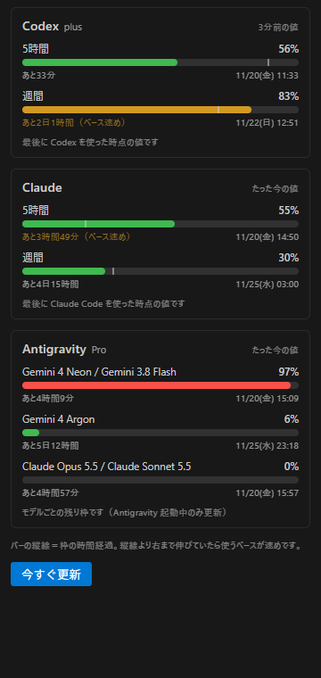

# Limit Radar

**See your Codex, Claude and Antigravity 5-hour / weekly limits at a glance — right in VS Code.**
No login, no tokens, no telemetry.

Codex・Claude・Antigravity の **5時間制限・週間制限** を VS Code のステータスバーとサイドパネルにまとめて表示します。（[日本語の説明は下にあります](#日本語)）



## Features

- **Status bar**: `Codex 56/58%` (5h / weekly), `Claude 42/12%`, `AG 7%` (busiest quota). Turns yellow at 80% and red at 95%
- **Notifications** when a window crosses the warning / critical threshold (once per window)
- **Side panel**: a bar per window, time until reset, and a **pace marker** (if the bar passes the marker, you are burning faster than time is passing)
- Works in WSL / SSH / Dev Containers — the extension runs on your local machine (`extensionKind: ui`)

## Install

Limit Radar is distributed on GitHub only (not on the VS Code Marketplace).

1. Download `limit-radar-x.y.z.vsix` from [Releases](https://github.com/asaiui/limit-radar/releases)
2. Install it:

```powershell
code --install-extension limit-radar-0.2.1.vsix
```

Or build it yourself from source: `npx @vscode/vsce package`

## How it gets the data

Limit Radar never asks you to sign in. It reads what each tool already keeps on **your own machine**.

| Service | Source | Network |
|---|---|---|
| Codex | `rate_limits` that Codex writes to `~/.codex/sessions/**/*.jsonl` | none |
| Claude | `rate_limits` from Claude Code's **official status line** input, saved by a tiny bridge script to `~/.claude/limit-radar/rate_limits.json` | none |
| Antigravity | per-model quota from the running Antigravity app (port listed in `~/.gemini/antigravity/daemon/hub_*.json`) | 127.0.0.1 only |

- No access to login tokens (unless you opt in to Claude API mode, below)
- No telemetry, no dependencies. All code is in this repository
- Codex and Claude values are **as of the last time you used that tool**. Windows past their reset time are shown as 0%
- The Codex log format and the Antigravity local API are undocumented and may change. When reading fails, Limit Radar says so and keeps the last known value

### Claude setup (one time)

Click **Set up** on the first-run prompt, or run **Limit Radar: Claude 連携をセットアップ** from the Command Palette.

- Registers the bridge script as `statusLine` in `~/.claude/settings.json` (requires Node.js)
- The bridge stores only the 5h / weekly percentage and reset time
- If you already have a custom status line, it is chained and keeps working
- Your previous settings are backed up to `~/.claude/limit-radar/settings.backup.json`
- **Limit Radar: Claude 連携を解除** restores the original setting (run it before uninstalling)
- **Note:** Claude Code runs status lines only in the **terminal (CLI)**. If you mainly use the Claude Code VS Code extension or the Claude desktop app, values will not update — consider API mode below

### Claude API mode (advanced, at your own risk)

Setting `limitRadar.claude.source` to `api` queries an undocumented usage endpoint with Claude Code's OAuth token. You get fresh values even when Claude Code is idle. However, using subscription tokens outside Claude Code may be restricted by Anthropic's terms, and the endpoint may stop working without notice. Off by default.

## Settings

| Setting | Default | Description |
|---|---|---|
| `limitRadar.codex.enabled` etc. | `true` | Show / hide each service |
| `limitRadar.claude.source` | `statusline` | `statusline` (recommended) or `api` |
| `limitRadar.claude.refreshSeconds` | `180` | Polling interval for API mode (min 60) |
| `limitRadar.warnPercent` | `80` | Yellow + notification threshold |
| `limitRadar.criticalPercent` | `95` | Red + notification threshold |
| `limitRadar.notifications` | `true` | Enable notifications |

## Disclaimer

Limit Radar is an unofficial tool and is not affiliated with OpenAI, Anthropic or Google.

---

## 日本語

アカウント連携やログインは不要です。各ツールが **あなたの PC に残している情報** を読むので、普段 Codex・Claude Code・Antigravity を使っていれば、そのアカウントの値がそのまま表示されます。

### できること

- **ステータスバー**: `Codex 56/58%`（5時間/週間）、`Claude 42/12%`、`AG 7%`（いちばん使っている枠）。80% で黄色、95% で赤色になります
- **通知**: しきい値を超えたときに知らせます（同じ枠では1回だけ）
- **サイドパネル**: 枠ごとのバー、リセットまでの残り時間、時間経過の縦線を表示します。縦線を超えていたら使うペースが速めです
- WSL・SSH・Dev Container でも、手元の PC 側で動きます

### インストール

GitHub でのみ配布しています（VS Code Marketplace には出していません）。

1. [Releases](https://github.com/asaiui/limit-radar/releases) から `limit-radar-x.y.z.vsix` をダウンロード
2. `code --install-extension limit-radar-0.2.1.vsix` でインストール

ソースから自分でビルドする場合は `npx @vscode/vsce package` を実行します。

### データの取り方と安全性

| サービス | 取得元 | 通信 |
|---|---|---|
| Codex | `~/.codex/sessions/**/*.jsonl` に Codex が記録する使用率 | なし |
| Claude | Claude Code 公式のステータスライン機能が渡す `rate_limits` を、中継スクリプトが `~/.claude/limit-radar/rate_limits.json` に保存したもの | なし |
| Antigravity | 起動中の Antigravity のローカルサーバー | 127.0.0.1 のみ |

- ログイントークンには触れません（Claude の API 方式を自分で有効にした場合を除く）
- テレメトリなし・依存パッケージなし
- Codex と Claude は **最後にそのツールを使った時点の値** です
- Codex と Antigravity は非公開の形式を読んでいるため、各ツールの更新で取れなくなることがあります。その場合は「取得できません」と表示し、前回の値を残します

### Claude 連携のセットアップ（初回のみ）

初回起動時の「セットアップ」を押すか、コマンドパレットで **Limit Radar: Claude 連携をセットアップ** を実行します。

- `~/.claude/settings.json` の `statusLine` に中継スクリプトを登録します（Node.js が必要）
- 保存するのは 5時間/週間 の使用率とリセット時刻だけです
- 独自のステータスラインを設定している場合は、それを引き継ぎます
- 変更前の設定は `~/.claude/limit-radar/settings.backup.json` にバックアップします
- **Limit Radar: Claude 連携を解除** で元に戻せます（アンインストール前に実行してください）
- **注意:** ステータスラインが動くのは **ターミナル版（CLI）の Claude Code だけ** です。VS Code の Claude 拡張やデスクトップアプリが中心の場合は値が更新されないため、下の API 方式を検討してください

### API 方式（上級者向け・自己責任）

`limitRadar.claude.source` を `api` にすると、Claude Code のログイントークンで非公開の使用量 API を問い合わせます。Claude Code を使っていなくても最新値が取れます。ただし、サブスクリプションのトークンを Claude Code 以外で使うことは規約上制限されている場合があり、予告なく使えなくなる可能性があります。既定ではオフです。

### 免責

非公式ツールです。OpenAI・Anthropic・Google とは関係ありません。
